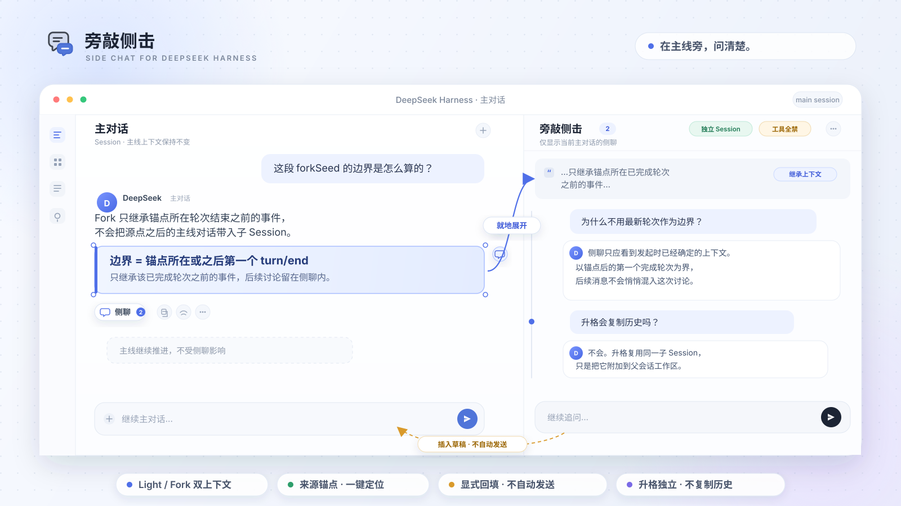

<p align="center">
  
</p>

<h1 align="center">Side Chat · 旁敲侧击</h1>

<p align="center">
  <strong>Ask focused questions beside a DeepSeek Harness reply, without interrupting the main thread.</strong><br>
  Keep the main conversation untouched. Bring content back only when you choose.
</p>

<p align="center">
  
  
  
</p>

<p align="center">
  <a href="README.md">简体中文</a> | English
</p>

<p align="center">
  
</p>

## Why Side Chat

- **In place**: start from selected text or the action under a reply, right beside the main conversation.
- **Context on your terms**: Light focuses on the quotation; Fork inherits main-thread events only up to the source's completed turn.
- **Main thread stays intact**: each side chat has its own DSH Session, so the parent's messages and context are never altered.
- **Explicit return**: copy an answer or insert a quote into the main conversation **draft**. Nothing is sent automatically.
- **Independent promotion**: promote the same child Session to a regular Session when needed; history is not copied, and promotion is not bring-back.

## Capabilities

- **Two entry points**: the side-chat action under an assistant reply, or the option in DSH's native quote capsule after selecting text.
- **Native right Sidebar**: directory, search, multi-turn conversation, and turn navigation live in DSH's Sidebar, with no extra floating rail.
- **Source anchors**: jump back and highlight either the whole reply body or the exact selected range, never the turn-tail toolbar.
- **Lifecycle**: archive, restore, and promote to a regular Session; promoted entries still open their side-chat details and native Session.
- **Host-enforced boundary**: authorization, parent/child ownership, and tool denial are enforced on the Host. Side-chat agents are denied **all** tools, including read-only tools.
- **Draft safety**: bring-back uses the native editor's quote insertion. A side chat can never append to or inject into the parent Session implicitly.

## Install

Open DSH Desktop → Plugins → Add plugin, choose the default npm registry, and enter:

```text
@jonge/dsh-sidechat
```

Enable the plugin and restart Desktop if needed.

> The installed version and release status are shown on the
> [npm package page](https://www.npmjs.com/package/@jonge/dsh-sidechat).

## Develop from source

Requirements: Node.js ≥ 24.9, pnpm 11.28.5, DSH 0.2.2-rc.5.

```bash
git clone https://github.com/NoName4Me/dsh-sidechat.git
cd dsh-sidechat
corepack enable
pnpm install --frozen-lockfile
pnpm typecheck
pnpm build
pnpm test
pnpm check:manifest
```

| Path          | Responsibility                                                                           |
| ------------- | ---------------------------------------------------------------------------------------- |
| `src/client/` | Message/selection actions, right Sidebar, transcript, source navigation, draft insertion |
| `src/host/`   | Authenticated RPC, DSH Agent/Session lifecycle, tool guard                               |
| `src/domain/` | Side Chat records, lifecycle, validation, persistence                                    |
| `src/shared/` | Host–Client channel identifiers                                                          |

Metadata is stored in `state/sidechat.json`; child Sessions use the `session-sidechat-` prefix. Pre-release experimental package identities are not part of the public contract, so no compatibility layer is maintained for them.

## Documentation

- [Product and interaction design (中文)](docs/design.md)
- [System architecture and flows (中文)](docs/architecture.md)
- [Development conventions (中文)](docs/development.md)
- [Status and acceptance (中文)](docs/roadmap.md)

## Known limitations

- The side panel prioritizes text messages; it does not replicate all native rich-media or tool-message UI.
- Source navigation requires the original parent message to be loaded.
- Basic functionality has been validated locally by the maintainer; broader window sizes, themes, and edge cases will continue to be covered after release.
- Host upgrades outside the target DSH version range require integration validation.

License: [MIT](LICENSE).
