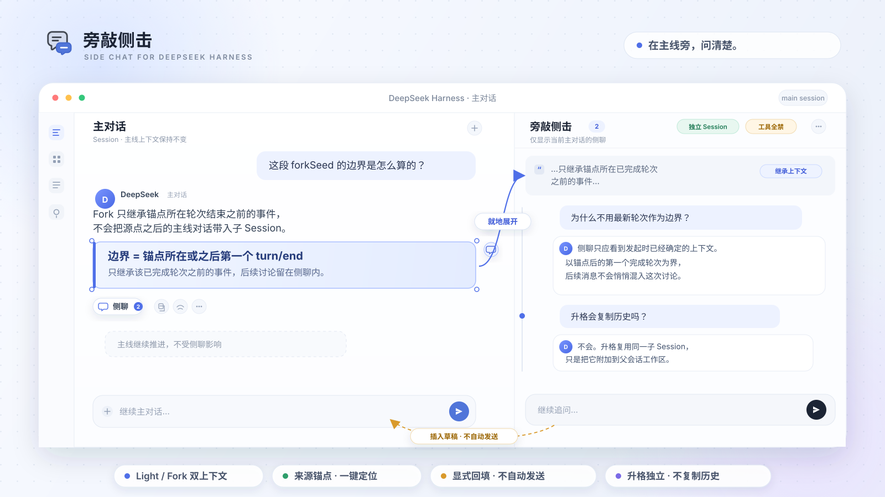

<p align="center">
  
</p>

<h1 align="center">旁敲侧击 · Side Chat</h1>

<p align="center">
  <strong>在主对话旁，就某段内容展开独立的多轮交流。</strong><br>
  不打断主线，不改动上下文，回填由你决定。
</p>

<p align="center">
  
  
  
</p>

<p align="center">
  <a href="README.en.md">English</a> · 简体中文
</p>

<p align="center">
  
</p>

## 为什么是侧聊

- **就地展开**：选中一段回复，或点击回复下方的「侧聊」图标，就在当前主对话右侧开始，不另开窗口。
- **上下文可选**：Light 只围绕引用讨论；Fork 继承锚点所在**已完成轮次之前**的主线事件。
- **主线不动**：侧聊有自己的 DSH Session；主对话的消息、顺序和上下文不会因为它而改变。
- **回流显式**：复制回答，或把引用插入主对话**草稿**；不会自动发送，也不会替你继续主线。
- **升格独立**：需要长期保留时，把同一个子 Session 升格为正式会话，不复制历史，也不等于回填。

## 核心能力

- **两种入口**：AI 回复下方的「侧聊」图标；选中文字后，在 DSH 原生「引用文本」胶囊中选择「侧聊」。
- **原生侧边栏**：目录、搜索、多轮会话和轮次导航都在 DSH 右侧 Sidebar 中，没有额外的浮动轨道。
- **来源锚点**：点击「定位并高亮原消息」，回到整条回复正文或原始选区；不会跳到回复底部的操作栏。
- **完整管理**：归档、恢复、升格为正式 Session；已升格记录仍可打开侧聊详情并跳转正式会话。
- **Host 强制边界**：授权、父子 Session 归属与工具限制都在 Host 执行；侧聊 Agent 默认拒绝**全部**工具，包括只读工具。
- **草稿安全**：插入主对话只调用原生编辑器写入草稿；侧聊永远不能隐式向主 Session 追加或注入消息。

## 安装

在 DSH Desktop 打开「插件」→「添加插件」，使用默认 npm 安装源输入：

```text
@jonge/dsh-sidechat
```

安装启用后，按需重新启动 Desktop。

> 安装版本与发布状态以 [npm 包页面](https://www.npmjs.com/package/@jonge/dsh-sidechat) 为准。

## 从源码开发

环境：Node.js ≥ 24.9、pnpm 11.28.5、DSH 0.2.2-rc.5。

```bash
git clone https://github.com/NoName4Me/dsh-sidechat.git
cd dsh-sidechat
corepack enable
pnpm install --frozen-lockfile
pnpm typecheck
pnpm build
pnpm test
pnpm check:manifest
```

| 路径          | 责任                                                   |
| ------------- | ------------------------------------------------------ |
| `src/client/` | 消息与选区入口、右侧面板、历史展示、原文定位、草稿回填 |
| `src/host/`   | 认证 RPC、DSH Agent/Session 生命周期、权限约束         |
| `src/domain/` | 侧聊元数据、生命周期、校验、存储                       |
| `src/shared/` | Client / Host 通道常量                                 |

元数据使用独立的 `state/sidechat.json`；子 Session ID 以 `session-sidechat-` 开头。早期试验包的存储及安装身份不属于公开契约，不保留兼容逻辑。

## 文档

- [产品与交互设计](docs/design.md)
- [系统架构与流程图](docs/architecture.md)
- [开发规范](docs/development.md)
- [开发进度与验收](docs/roadmap.md)

## 当前限制

- 侧聊面板以文字消息为主，尚未复刻全部原生富媒体与工具消息 UI。
- 来源消息必须已在主对话中加载，才能定位和高亮。
- 维护者已在本地完成基本功能验收；发布后继续回归更多窗口尺寸、主题与边界场景。
- 当前只支持指定 DSH 版本区间，升级宿主前应重新验证。

许可证：[MIT](LICENSE)。
