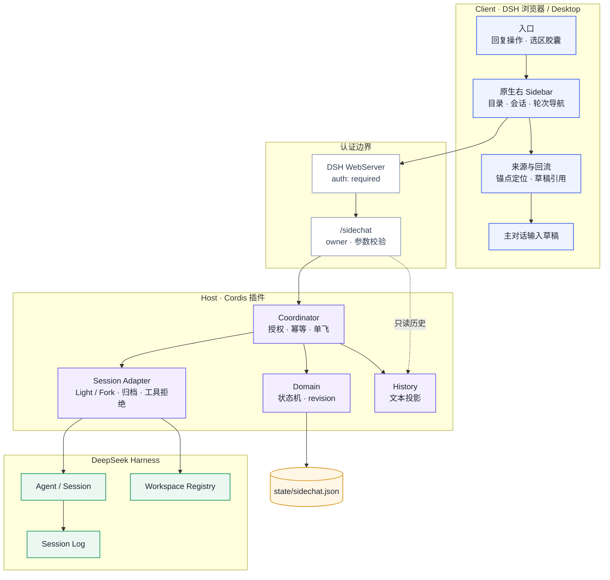
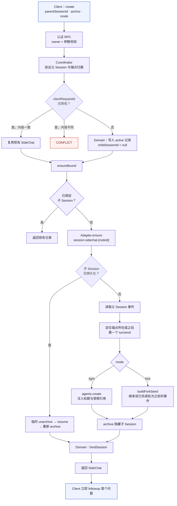
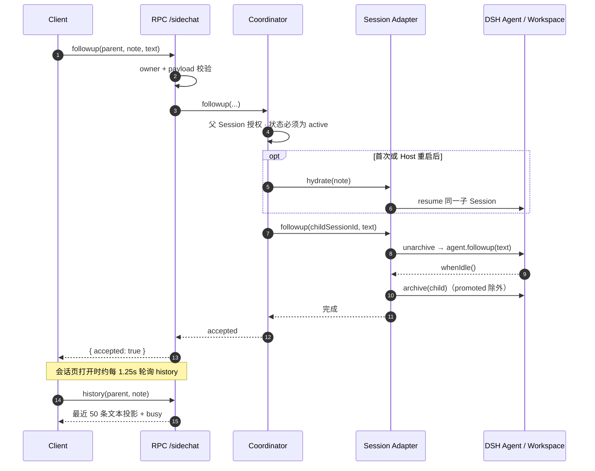
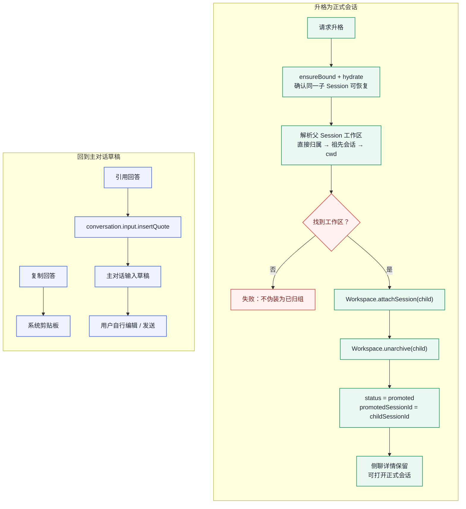
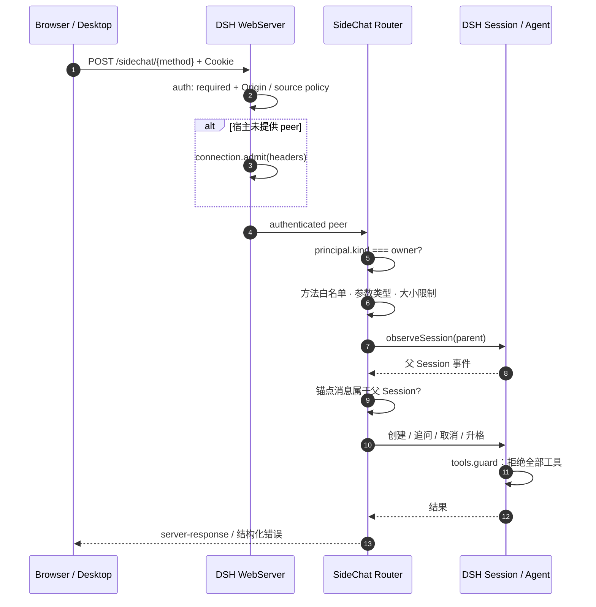

# 系统架构

> **旁敲侧击 / Side Chat** · 面向 DeepSeek Harness `0.2.2-rc.5`
>
> 本文描述**当前源码已经实现的架构**。自动化检查与维护者本地验收状态见
> [路线图](roadmap.md)。

## 1. 架构原则

1. **Host 是唯一权威**：授权、父子 Session 归属、上下文边界、生命周期和工具限制都在 Host 执行。
2. **主对话不可隐式变更**：侧聊永远不向父 Session 追加、注入或修改消息。
3. **Client 只做投影与意图**：浏览器负责入口、目录、消息展示和来源定位，不直接读写 Session 存储。
4. **运行时严格分层**：Host 为 Node ESM，Client 为 DSH 经典脚本模块工厂，跨边界只传可序列化协议。
5. **子 Session 身份可恢复**：`session-sidechat-{noteId}` 是确定性的；创建与绑定失败后可以重试，不产生孤儿。
6. **默认拒绝**：侧聊 Agent 的工具执行全部由 Host 工具守卫拒绝，不依赖提示词或隐藏 UI。
7. **显式回流**：复制或插入主对话草稿由用户主动触发；升格是另一条独立路径。

## 2. 运行时总览



| 层       | 代码位置                                       | 责任                                                           |
| -------- | ---------------------------------------------- | -------------------------------------------------------------- |
| Client   | `src/client/`                                  | 入口、意图、原生右 Sidebar、目录、消息投影、来源定位、草稿回填 |
| 认证 RPC | `src/host/secured-route.ts`、`src/host/rpc.ts` | DSH 认证、owner 校验、请求大小与参数校验、结构化错误           |
| Host     | `src/host/index.ts`、`coordinator.ts`          | 生命周期编排、授权、幂等、单飞、Agent/Session 协作             |
| Domain   | `src/domain/`                                  | 记录模型、状态转移、校验、JSON Repository                      |
| DSH      | 宿主服务                                       | Agent 推理、Session 事件日志、Fork、归档/恢复、工作区归属      |
| Store    | `state/sidechat.json`                          | Side Chat 元数据；不复制完整对话历史                           |

## 3. 模块地图

| 模块         | 关键文件                             | 说明                                                                                |
| ------------ | ------------------------------------ | ----------------------------------------------------------------------------------- |
| 插件入口     | `src/host/index.ts`                  | 注入 `agents`、`sessionQuery`、`workspaceRegistry`、`tools`、`webServer` 等宿主服务 |
| RPC 路由     | `src/host/rpc.ts`                    | `list/create/get/history/followup/cancel/archive/restore/promote`                   |
| Web 边界     | `src/host/secured-route.ts`          | `auth: required` 前缀路由；96 KB 请求上限；拒绝匿名调用                             |
| 授权         | `src/host/access.ts`                 | 从 DSH Session 日志验证父 Session 与锚点，而非信任浏览器                            |
| 编排         | `src/host/coordinator.ts`            | 授权、幂等、并发合并、`ensureBound`、`hydrate`、升格                                |
| Session 适配 | `src/host/dsh-session-adapter.ts`    | 确定性子 Session、Light/Fork 创建、归档/恢复、升格                                  |
| 官方桥接     | `src/host/dsh-runtime-bridge.ts`     | `agents.create/resume`、`buildForkSeed`、`workspaceRegistry`、`tools.guard`         |
| 历史投影     | `src/host/history.ts`                | 过滤 Fork 继承前缀，仅返回受限的 user/assistant 文本与 reasoning                    |
| Client 入口  | `src/client/index.ts`                | 注册右侧标签页、消息操作、选区操作、锚点层                                          |
| 侧聊页面     | `src/client/SideChatOverlay.tsx`     | 目录、创建、会话、工具栏、升格入口                                                  |
| 意图与目录   | `src/client/intent.ts`、`catalog.ts` | 跨 Slot 的发起意图、Session 级目录缓存与预览                                        |
| 来源定位     | `src/client/source-anchor.ts`        | 定位 `assistant-step` 正文与文本 Range；不指向 `turn-tail`                          |
| 草稿回填     | `src/client/bring-back.ts`           | 调用主对话编辑器 `insertQuote`，不发送消息                                          |

## 4. 关键流程

### 4.1 创建侧聊与选择上下文



**上下文边界规则**

- **Light**：不继承父 Session 事件；只把标题和最多 8,000 字符的选中文本作为子 Agent 的首步来源上下文。
- **Fork**：从锚点消息出发，找到锚点所在或紧随其后的第一个 `turn/end`，只继承该已完成轮次之前的事件。锚点后尚未完成或之后的对话不会进入子 Session。
- 两种模式都通过 DSH Agent 生命周期创建持久化子 Session；不把内存 `fork()` 当成完整 Agent。
- 若锚点消息不存在或锚点轮次尚未完成，创建失败，不生成子 Session。
- 元数据先写入、Session 后绑定是刻意设计：创建失败会留下未绑定记录，重试通过确定性 ID 恢复同一个子 Session。

### 4.2 追问、停止与历史投影



- 追问文本上限 32,000 字符；只允许 `active` 状态继续追问。
- 每个子 Session 的生成期间保持可见，`whenIdle()` 后重新归档；已升格的 Session 不再归档。
- 历史只投影子 Session 的 `user/message` 与 `assistant/message`，并过滤 `inheritedEventCount` 之前的 Fork 前缀。
- 单条文本上限 16,000 字符、reasoning 上限 8,000 字符；不返回注入上下文、工具输出或原始事件。

### 4.3 归档、恢复与升格



- 元数据 `archive` / `restore` 只改变目录状态；子 Session 本身在空闲时已隐藏，追问前会临时解除归档。
- 升格复用**同一个子 Session**，不复制消息历史到父 Session。
- 父 Session 不属于任何工作区时升格失败；不会把侧聊伪装成已归组的正式会话。
- 升格与回流互不依赖：升格不向主对话写入内容，回流也不会改变侧聊状态。

## 5. 认证与数据边界



| 控制点     | 实现                                                                                      |
| ---------- | ----------------------------------------------------------------------------------------- |
| 传输认证   | `registerSideChatWebRoute` 使用 `kind: 'prefix'`、`path: '/sidechat'`、`auth: 'required'` |
| 匿名拒绝   | 路由缺失 peer 时通过官方 `connection.admit` 重新认证；失败返回 401                        |
| owner 校验 | Router 在解析 payload 前检查 `peer.principal.kind === 'owner'`                            |
| 来源校验   | 每次创建读取父 Session 日志，验证锚点消息真实存在且属于该 Session                         |
| 请求限制   | 请求体上限 96 KB；`clientRequestId` ≤ 128；选中文本 ≤ 8,000；标题 ≤ 120；追问 ≤ 32,000    |
| 工具限制   | Agent `setup` 与 `resume` 都安装 `tools.guard`，对子 Agent 的每次工具执行返回拒绝原因     |
| 错误响应   | 只返回 `sidechat/*` 结构化错误；不回传提示词、路径、Token 或堆栈                          |
| 日志       | 不记录 Token、选中内容、私聊正文或工作区文件内容                                          |
| 历史边界   | 只返回子 Session 的文本投影；不暴露内部注入上下文、工具输出或完整原生事件                 |

这是携带 DSH Connection 请求/响应 Envelope 的**认证 Web RPC**，不是公开、匿名的 HTTP API。实现选择直接注册 WebServer 前缀路由，以避免依赖版本敏感的 Connection 注册上下文，同时保留官方认证与 Envelope 兼容。

## 6. 持久化与一致性

```ts
interface StoredDocument {
  version: 1
  notes: SideChat[]
}
```

- 路径：`dshHomePath('state', 'sidechat.json')`。
- 写入：临时文件 + `rename` 原子替换，文件模式 `0o600`；单进程串行队列。
- 幂等：`(parentSessionId, clientRequestId)` 唯一；重复创建返回同一条记录。
- 并发：更新使用 `revision` 比较交换（CAS）；冲突时重试，三次后报 `CONFLICT`。
- 恢复：子 Session ID 由记录 ID 推导；即使元数据绑定前进程退出，下一次 `ensure()` 也能恢复同一 Session。
- 限制：Repository 是**单进程 JSON 存储**，多个 DSH Host 进程不能安全并发写同一文件。

## 7. DSH 集成点

### Host 服务

| 能力                   | 官方接入点                                                        |
| ---------------------- | ----------------------------------------------------------------- |
| 读取父/子 Session 事件 | `ctx.sessionQuery.observeSession(SessionId(id))`                  |
| Fork 继承指定前缀      | `buildForkSeed(events, SessionSeq(boundary))`                     |
| 创建 / 恢复子 Agent    | `ctx.agents.create(…)` / `ctx.agents.resume(…)`                   |
| 追问 / 停止            | `agent.followup(…)` / `agent.cancel(…)`                           |
| 归档 / 恢复            | `ctx.workspaceRegistry.archiveSession(…)` / `unarchiveSession(…)` |
| 升格归组               | `Workspace.attachSession(…)`                                      |
| 工具拒绝               | Agent `setup` 内 `agentCtx.tools.guard(…)`                        |

### Client Slot

| Slot                                  | 用途                         |
| ------------------------------------- | ---------------------------- |
| `conversation.chat.assistant-actions` | AI 回复下方的「侧聊」图标    |
| `shell.overlay`                       | 文本选区胶囊扩展、来源侧标记 |
| `sidebarRightTabs.register(…)`        | 注册原生「旁敲侧击」标签页   |
| `sidebar.right.pane.tab`              | 渲染目录、创建页与会话页     |

选区入口在 `pointerup` / 完成后触发，不监听 `selectionchange`。DSH 当前提供的是独占式 Quote 文本交互 Seat，因此 Client 通过 React Portal 把「侧聊」附加到原生引用胶囊，而不是替换原生 Quote 行为。

## 8. 构建产物与运行时边界

| 产物            | 格式             | 约束                                                                           |
| --------------- | ---------------- | ------------------------------------------------------------------------------ |
| `lib/index.mjs` | Node ESM         | Host 侧；只允许 Node 模块                                                      |
| `lib/client.js` | CJS 经典脚本工厂 | 由 `window.__ModuleLoader__.load({ id: '@jonge/dsh-sidechat', factory })` 包装 |

Client **不能**输出裸 ESM；React、React DOM 与原生 Primitives 由宿主提供。`scripts/check-build.mjs` 会实际执行加载器包装并核对模块 ID 与工厂格式，而不是只检查文件存在。

## 9. 验证边界

CI 已覆盖：

- Node 24 与 DSH `0.2.2-rc.5` 的 TypeScript 检查、Host/Client 打包、Manifest 与 npm pack 检查。
- 领域状态机、持久化幂等、Coordinator 授权、RPC owner 校验、历史投影、Session 适配与官方桥接契约。
- DSH Web Profile 安装、Host 激活、浏览器 Cookie 认证、`/sidechat/list` 认证 RPC 可达，以及匿名请求被拒绝。

维护者已在本地完成基本功能验收；发布后仍需继续回归真实引用胶囊、长文本与重复选区定位、跨重启恢复、升格后可见性、深浅主题与窄窗口等边界场景。通过 RPC 冒烟不代表这些场景全部覆盖。

## 10. 上游参考

- [DSH Host 核心架构](https://github.com/deepseek-ai/deepseek-harness/blob/master/docs/subsystems/core.md)
- [UI Slots](https://github.com/deepseek-ai/deepseek-harness/blob/master/docs/subsystems/slots.md)
- [原生右侧 Sidebar](https://github.com/deepseek-ai/deepseek-harness/blob/master/docs/subsystems/sidebar-right.zh.md)
- [客户端原生消息操作](https://github.com/deepseek-ai/deepseek-harness/blob/master/packages/client/ui-chat/src/client/chat/MessageIconActions.tsx)
