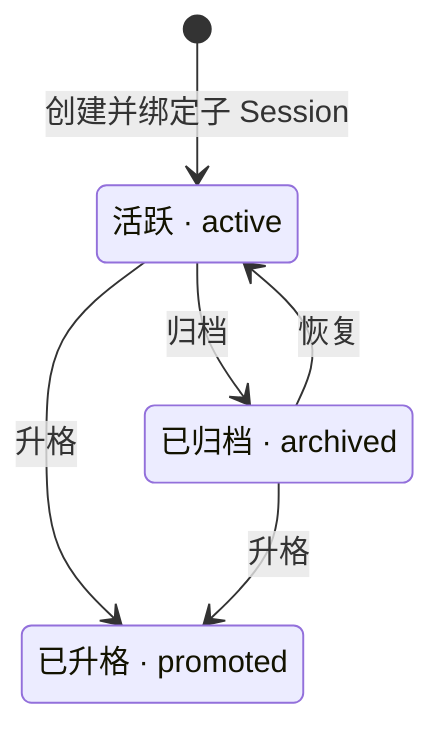

# 产品与交互设计

> **旁敲侧击 / Side Chat** · 面向 DeepSeek Harness `0.2.2-rc.5`
>
> 本文描述产品行为与交互设计；Host / Client 分层、RPC 与数据一致性见
> [系统架构](architecture.md)。

## 1. 产品定位

用户在主对话中遇到术语、代码片段或想进一步讨论的观点时，应当能**就地展开独立的多轮侧聊**，而不改变主会话的消息顺序、上下文和输入草稿。

产品名：**旁敲侧击 / Side Chat**。UI 动作：**侧聊**。

### 基本原则

1. **来源明确**：从 AI 回复或文本选区发起，持久化父 Session、源消息 ID、可选原文和上下文范围。
2. **主线隔离**：侧聊使用自己的 DSH Agent / Session；主对话不自动接收侧聊的输入或输出。
3. **回流由用户决定**：复制回答，或把引用插入主对话**草稿**；永不自动发送。
4. **生命周期独立**：侧聊可归档、恢复、升格为正式 Session；升格不等于回流。
5. **扩展优先**：只使用 DSH Cordis、Agent/Session、官方 UI Slot 与原生右 Sidebar，不替换主聊天内核。

### 非目标

- 不实现通用对话分支图或任意层级侧聊树。
- 不让侧聊 Agent 自主修改工作区、执行命令或调用工具。
- 不复制一套完整的原生多模态聊天组件。
- 不在主对话中自动插入、发送或“继续”任何侧聊内容。

## 2. 用户旅程

| 阶段 | 用户看到什么                                                | 系统保证                               |
| ---- | ----------------------------------------------------------- | -------------------------------------- |
| 发起 | AI 回复下方的双气泡图标；选中文字后原生引用胶囊中的「侧聊」 | 条目锚定到具体回复与可选原文           |
| 创建 | 引用块、Light / Fork 选择、一个输入框                       | 首个问题与侧聊创建是一条操作路径       |
| 追问 | 原生右 Sidebar 中的多轮会话、左侧轮次圆点、停止按钮         | 每轮使用独立 Session；主对话不追加消息 |
| 定位 | 顶部「定位并高亮原消息」；消息右侧的小侧聊标记              | 整条回复定位到正文，选区只高亮匹配片段 |
| 回流 | 回答下方「复制」与「引用到主对话草稿」                      | 只写入草稿，不发送                     |
| 管理 | 目录搜索、归档、恢复、升格                                  | 升格复用同一子 Session，不复制历史     |

## 3. 交互与视觉

### 3.1 发起侧聊

- **整条回复入口**：AI 回复下方使用双气泡图标，悬浮提示「侧聊」；点击后右侧打开创建页。
- **选区入口**：鼠标松开或键盘扩展选区完成后，在 DSH 原生「引用文本」胶囊中增加「侧聊」操作。
- 拖动选区期间不显示新按钮，不监听 `selectionchange`，避免与原生引用胶囊争抢定位和闪烁。
- 选区只在同一个 `data-text-interaction-source` 内生效；跨来源、空选区或超过 8,000 字符时不提供入口。
- Light（默认）只提供必要的引用背景；Fork 继承源消息所属**已完成轮次之前**的主线事件。

### 3.2 唯一目录

- 侧聊目录只存在于 DSH **原生右 Sidebar** 的「旁敲侧击」页面；没有额外的浮动圆点轨道。
- 标题优先取首个问题并压缩为单行；引用原文保留在侧聊顶部与目录预览中。
- 支持按引用内容、标题与回答搜索；可归档、恢复、升格。
- 已升格记录仍可打开侧聊详情，并从详情底部跳转到对应的 DSH 正式会话。
- 消息正文右侧靠近来源顶部或原始选区位置显示小型侧聊标记。悬浮展示标题与首个问题，点击直接打开对应侧聊。

### 3.3 会话页

- **引用块**：浅色底色 + 紧凑方形引号图标；创建页最多展示三行并省略更长内容。
- **消息**：用户消息使用中性浅色 Token 气泡；AI 回答复用 DSH 原生 `MarkdownText` body 与代码高亮，思考块使用原生折叠行。
- **操作栏**：从正文左侧起排，包含复制、引用到主对话草稿，并在按钮后显示日期时间。
- **轮次导航**：会话左侧竖向圆点；悬浮或聚焦显示该轮问题与回答摘要，点击滚动到对应轮次，并随滚动高亮当前轮次。
- **输入区**：单个自动增高 textarea，最大 180px；禁用拖拽角标；右下角一个圆形发送按钮，生成期间同位置切换为停止。
- **配色**：侧聊发送按钮使用深色主操作样式，与主对话蓝色气泡、蓝色发送按钮区分；其余使用 DSH `--dsw-*` 主题 Token。
- 遵循深浅模式、`prefers-reduced-motion` 与紧凑窗口；窄侧栏下输入区随宽度重新换行和增高。

### 3.4 回到来源

- **全回复锚点**：滚动到真正的 `assistant-step` 回复正文，并对整条回复闪烁高亮；绝不把 `turn-tail` 底部工具栏当作目标。
- **选区锚点**：在来源文本节点上恢复 DOM Range，只高亮匹配片段；富文本跨节点可以匹配。
- 原文未加载或文本已变化导致精确匹配失败时显示错误，不随意高亮其他内容。
- 同一内容在会话中重复出现时，当前实现可能命中第一个匹配；稳定选区偏移属于后续增强。

### 3.5 回流与升格

这是两条独立路径：

| 动作             | 结果                                        | 不会发生什么                           |
| ---------------- | ------------------------------------------- | -------------------------------------- |
| 复制回答         | 写入系统剪贴板                              | 不触碰主对话                           |
| 引用到主对话草稿 | 通过原生编辑器 `insertQuote` 写入主输入框   | 不自动发送、不改变侧聊状态             |
| 升格为正式会话   | 同一子 Session 附加到父会话工作区并解除归档 | 不把历史复制进父 Session，也不等于回填 |

升格后侧聊详情继续可见，不再提供重复的归组操作；若正式会话仍存在，底部提供「打开正式会话」入口。父会话不属于任何工作区时升格失败，并明确提示，而不是伪装成已归组。

## 4. 状态与数据

每条 Side Chat 记录独立元数据；完整消息历史仍由 DSH Session 保存。

```ts
type ContextMode = 'light' | 'fork'
type SideChatStatus = 'active' | 'archived' | 'promoted'

interface SideChat {
  id: string
  parentSessionId: string
  childSessionId: string | null
  clientRequestId: string
  anchor: {
    messageId: string
    eventSeq?: number
    selectedText?: string
  }
  title: string
  mode: ContextMode
  status: SideChatStatus
  promotedSessionId?: string
  revision: number
  createdAt: string
  updatedAt: string
}
```



| 状态       | 目录默认可见           | 可追问           | 可归档 / 恢复 | 说明                            |
| ---------- | ---------------------- | ---------------- | ------------- | ------------------------------- |
| `active`   | 是                     | 是               | 是            | 正常侧聊；子 Session 空闲时隐藏 |
| `archived` | 否（可包含归档后列出） | 否，需先恢复     | 是            | 仅元数据状态；不删除历史        |
| `promoted` | 是                     | 在正式会话中继续 | 否            | 终态；保留同一子 Session        |

### 一致性约束

- 重复创建通过 `clientRequestId` 幂等；同一个请求键不能悄悄对应不同锚点或标题。
- 更新检查 `revision`；状态转移使用比较交换，避免并发覆盖。
- 同一来源可以建立多个侧聊；来源消息不可见时目录仍应可用。
- 元数据存储为单进程 `state/sidechat.json`，不保证多个 DSH Host 进程并发写入。
- 不存储模型密钥，也不保存第二份完整 Session 对话历史。

## 5. 边界与验收

已实现范围、CI 覆盖与仍需 Desktop 人工验收的项目，以 [路线图](roadmap.md) 为准。设计上必须持续满足：

- 主 Session 不被侧聊隐式修改。
- 授权、owner 检查与 deny-all 工具限制在 Host 强制执行。
- 回流只写入草稿，永不自动发送。
- 侧聊目录只出现在原生右 Sidebar。
- 整条回复定位指向正文，不指向底部操作栏。
